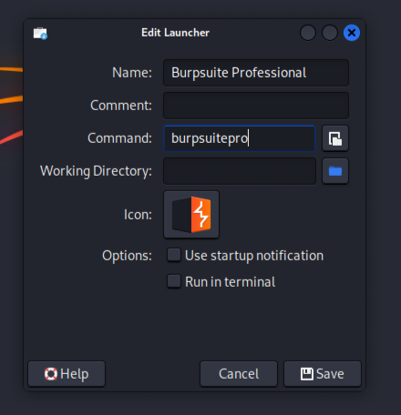

<div align="center">

# $${\color{orange}Burpsuite-Professional-v2026-latest}$$
</div>

<p align="center"> Burp Suite Professional is the web security tester's toolkit of choice. Use it to automate repetitive testing tasks - then dig deeper with its expert-designed manual and semi-automated security testing tools. Burp Suite Professional can help you to test for OWASP Top 10 vulnerabilities - as well as the very latest hacking techniques. Advanced manual and automated features empower users to find lurking vulnerabilities more quickly. Burp Suite is designed and used by the industry's best.</p>

<h3 align="center">

[Overview](https://portswigger.net/burp/pro)
</h3>
 
<br>
<br>

# $${\color{magenta}Linux-Installation}$$

### Option 1: One-Liner Quick Install (Recommended)
```sh
sudo apt update && sudo apt install -y wget git && wget -qO- https://raw.githubusercontent.com/IshantSomani/Burpsuite-Professional/main/install.sh | sudo bash
```

### Option 2: Manual Clone & Install
```sh
sudo apt update && sudo apt install -y git wget openjdk-21-jre
git clone https://github.com/IshantSomani/Burpsuite-Professional.git
cd Burpsuite-Professional
chmod +x install.sh
sudo ./install.sh
```

## Run
From terminal:
```sh
burpsuitepro
```
Or find **Burp Suite Professional** in your Kali Application Menu under **03 - Web Application Analysis** -> **Web Application Proxies**.

---

## ☕ Java Version Requirement (OpenJDK 21)

> [!IMPORTANT]
> BurpLoaderKeygen (`loader.jar`) requires **OpenJDK 21** or **OpenJDK 17**.
> Bleeding-edge Kali rolling versions (e.g. Java 22, 23, 24, 25) break bytecode agent patching, causing license rejection.
> 
> The `install.sh` and `update.sh` scripts automatically detect and switch system-wide Java to OpenJDK 21 for you. If you ever need to manually switch your system Java runtime to Java 21, run:

```sh
# Set Java 21 non-interactively (AMD64 / x86_64):
sudo update-alternatives --set java /usr/lib/jvm/java-21-openjdk-amd64/bin/java

# Or on ARM machines:
sudo update-alternatives --set java /usr/lib/jvm/java-21-openjdk-arm64/bin/java

# Or choose interactively:
sudo update-alternatives --config java
```

---

## Setup Licenses

Follow these exact steps when activating:

1. **In `loader.jar`**:
   - Type your name into **License to:** (e.g. `IshantSomani`).
   - Copy the entire string from the **License** box (`Ctrl + A`, `Ctrl + C`).
2. **In Burp Suite Pro**:
   - Paste the copied license string into the box and click **Next**.
   - Because the offline keygen cannot verify with PortSwigger online, Burp will prompt you for manual activation.
   - Click the **Manual activation** button (bottom right).
3. **Exchange Keys**:
   - In Burp, click **Copy Request**.
   - In `loader.jar`, paste the copied request into the **Activation Request** box.
   - In `loader.jar`, the **Activation Response** is automatically generated. Click **Copy** next to it.
   - In Burp, click **Paste Response**.
4. **Finish**:
   - Click **Next** -> Click **Finish**. Burp Suite Professional is now fully activated!

<div align="center">
 
https://github.com/IshantSomani/Burpsuite-Professional/assets/117867334/c25831a4-68a2-44ee-b6dd-5ff18165f340
</div>

<br>

<details><summary><b>🔄 Update Burp Suite Pro</b></summary>

```sh
cd && sudo rm -rf Burpsuite-Professional && wget -qO- https://raw.githubusercontent.com/IshantSomani/Burpsuite-Professional/refs/heads/main/update.sh | sudo bash
```
Or from an existing clone:
```sh
cd ~/Burpsuite-Professional && git pull && sudo ./update.sh
```
</details>

<br>

## Shortcut Launcher - (xfce)
Right-click Desktop -> Create Launcher -> Name: `Burp Suite Professional`, Command: `burpsuitepro`, Icon: Select Burp Suite icon.

<div align="center">
 
</div>

<br>
<br>

---------

# $${\color{magenta}NixOS-Installation}$$

## Add this repo's flake to your flake inputs
```
# flake.nix
{
  # ...
  inputs = {
    burpsuitepro = {
      type = "github";
      owner = "IshantSomani";
      repo = "Burpsuite-Professional";
      inputs.nixpkgs.follows = "nixpkgs";
    };
  };
  # ...
}
```

## Installing the package provided by the flake
## You can install it with either `environment.systemPackages` or `home.packages`
> With `environment.systemPackages` (nixosModules)

  ```
    { inputs, ... }: {
      environment.systemPackages = [
        inputs.burpsuitepro.packages.${system}.default
      ];
    }
  ```

> With `home.packages` (home-manager)
 ```
    { inputs, ... }: {
      home.packages = [
        inputs.burpsuitepro.packages.${system}.default
      ];
    }
  ```

NOTE: `loader.jar` is symlinked to `burpsuite.jar` so burpsuite recognizes the license keys. You can access the `loader` command from the terminal only

<br>
<br>

----------

# $${\color{magenta}Windows-Installation}$$
 
- Make a `Burp` directory name in `C Drive` for faster access.

- Download [install.ps1](https://codeload.github.com/IshantSomani/Burpsuite-Professional/zip/refs/heads/main) and extract move the file inside to `C:\Burp`

- Open `Powershell` as administrator and execute below command to set Script Execution Policy.


      Set-ExecutionPolicy -ExecutionPolicy bypass -Scope process

- Inside PowerShell go to `cd C:\Burp`

- Now Execute `install.ps1` file in Powershell to Complete Installation.

      ./install.ps1
 
- Change the icon of `Burp-Suite-Pro.vbs` to the given icon 

- Create a shortcut to Desktop. Right Click over `Burp-Suite-Pro.vbs` Go to Shortcut tab, and below there is `Change Icon` tab

- Click there and choose the `burp-suite.ico` from `C:\Burp\`

   <div align="center">
    
    
</div>

- For Start Menu Entry, copy `Burp-Suite-Pro.vbs` file to 

      C:\ProgramData\Microsoft\Windows\Start Menu\Programs\

<br>
<br>

------------

# $${\color{magenta}MacOS-Installation}$$ 

## Step 1: Install Dependencies with Homebrew
Install Homebrew and required dependencies (`git`, `openjdk@17`).

```bash
/bin/bash -c "$(curl -fsSL https://raw.githubusercontent.com/Homebrew/install/HEAD/install.sh)"
brew install git openjdk@17
```

## Step 2: Run the Installation Script
Clone the Burp Suite Professional repository, download the Burp Suite JAR file, and execute the key generator and Burp Suite.

```bash
curl -fsSL https://raw.githubusercontent.com/IshantSomani/Burpsuite-Professional/main/install_macos.sh | bash
```

## Step 3: Install the `burp` Shortcut
Make the `burp` script executable and install it globally.

```bash
chmod +x burp
sudo cp burp /usr/local/bin/burp
```

**Explanation**:
- The `installmacos.sh` script creates a `burp` script to run Burp Suite with required Java options.
- Uses `$(pwd)` to reference JAR files in the current directory.
- Makes the script executable and copies it to `/usr/local/bin` for global access.


## Notes
- **Running the Shortcut**: Run `burp` from the `Burpsuite-Professional` directory containing `loader.jar` and `burpsuite_pro_v2025.5.6.jar`. For global use, replace `$(pwd)` with absolute paths.

## Contributors 

<a href="https://github.com/IshantSomani/Burpsuite-Professional/graphs/contributors">
  
</a>

## Credits
- Loader.jar 👉 [h3110w0r1d-y](https://github.com/h3110w0r1d-y/BurpLoaderKeygen)
- Script 👉 [cyb3rzest](https://github.com/cyb3rzest/Burp-Suite-Pro)
